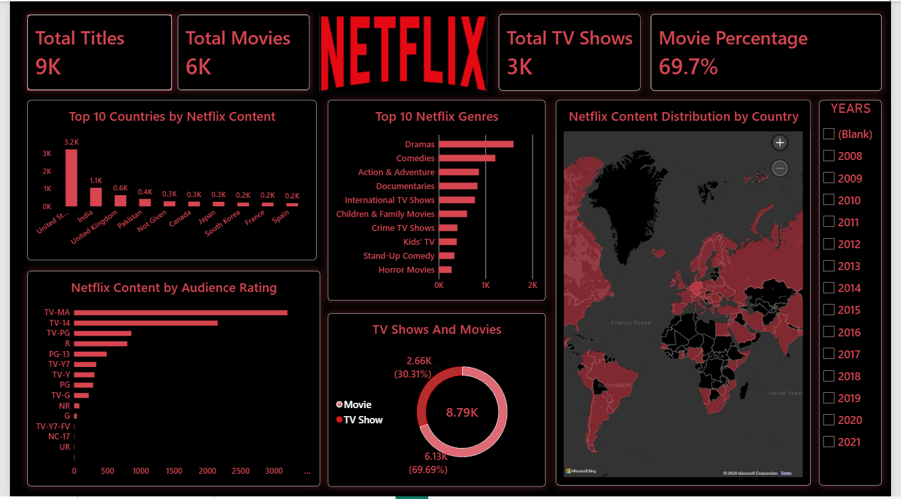
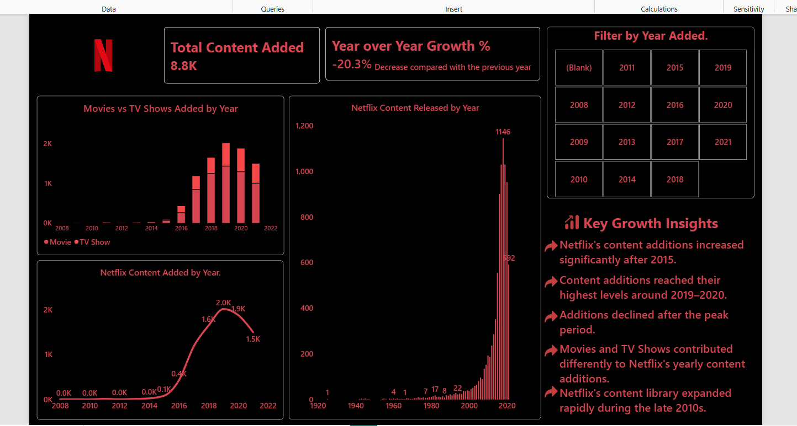
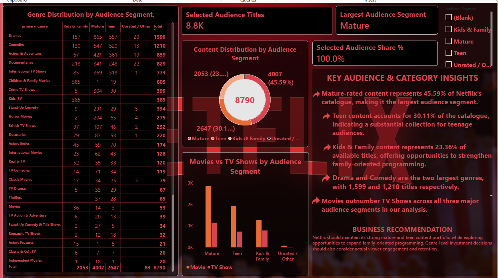

# 🎬 Netflix Data Analysis & Business Intelligence

<p align="center">
  
  
  
</p>

<p align="center">
  <b>Turning raw Netflix data into meaningful insights through Python, Power BI and data storytelling.</b>
</p>

---

## 📌 About the Project

What can Netflix's content library tell us about its global reach, content preferences and growth over time?

That was the idea behind this project.

As part of my **Power BI Internship at Auspify Technologies**, I worked with a Netflix titles dataset to explore its content catalogue, uncover patterns and transform raw data into interactive dashboards.

My goal wasn't just to create visualizations. I wanted to understand the story behind the numbers and explore how data could support better business decisions.

Throughout this project, I worked on five internship tasks, covering everything from data cleaning and preparation to global content analysis, growth trends and audience segmentation.

## 🛠️ Tools & Technologies

| Tool | How I used it |
|---|---|
| Power BI | Interactive dashboards and data visualization |
| Python | Data cleaning and preprocessing |
| Pandas | Data manipulation and transformation |
| Power Query | Data preparation and transformation |
| DAX | KPIs, calculations and dynamic measures |
| CSV | Dataset storage and processing |

## 📂 Project Structure

```text
Netflix-PowerBI-Internship/
│
├── data/
│   ├── Dataset.csv
│   ├── netflix_cleaned.csv
│   ├── netflix_country_map.csv
│   └── netflix_intermediate.csv
│
├── reports/
│   ├── netflix_auspify.pbix
│   └── data_quality_report.csv
│
├── screenshots/
│   ├── 01_Content_Overview.png
│   ├── 02_Content_Growth_Trends.png
│   └── 03_Audience_Category_Intelligence.png
│
├── clean_data.py
├── prepare_country_map.py
└── README.md
```

---

## 📊 Internship Tasks & Work Completed

### 01. Data Preparation & Power BI Setup

Every meaningful analysis starts with good-quality data.

For this task, I explored the Netflix dataset and prepared it for further analysis.

**What I worked on:**
- Imported and explored the original Netflix dataset.
- Standardized column names and cleaned text values.
- Checked missing values and duplicate records.
- Performed date transformations and feature engineering.
- Created intermediate and cleaned datasets.
- Generated a data quality report.

**Key learning:** Data cleaning, Python, Pandas and Power Query.

---

### 02. Netflix Content Overview

The first dashboard provides an overall picture of Netflix's content library.

**What I analysed:**
- Total titles, Movies and TV Shows.
- Movie vs TV Show distribution.
- Audience rating distribution.
- Top genres by content count.
- Country-wise content representation.
- Interactive year filters.

**Key learning:** KPI development, dashboard design and data visualization.

### Dashboard Preview

<p align="center">
  
</p>

---

### 03. Global Content Insights

Next, I explored how Netflix's content is distributed across different countries.

**What I worked on:**
- Country-wise content analysis.
- Global content distribution using map visualization.
- Top 10 countries by content representation.
- Country-level comparisons.
- Interactive geographic exploration.

**Key learning:** Geographic analysis and global content insights.

*The country analysis counts title-country associations, so a title available across multiple countries can contribute to more than one country.*

---

### 04. Content Growth & Trend Analysis

This dashboard focuses on how Netflix's content catalogue has evolved over time.

**What I analysed:**
- Content distribution by original release year.
- Year-wise Netflix content additions.
- Movies vs TV Shows added each year.
- Year-over-Year growth calculations using DAX.
- Major content expansion periods.
- Historical growth patterns and observations.

**Key learning:** Time-series analysis, DAX and trend visualization.

### Dashboard Preview

<p align="center">
  
</p>

---

### 05. Audience & Content Category Intelligence

For this task, I focused on understanding the different audience segments represented in Netflix's catalogue.

**What I worked on:**
- Created four audience segments using DAX:
  - Mature
  - Teen
  - Kids & Family
  - Unrated / Other
- Analysed audience segment distribution.
- Identified the Top 10 genres.
- Compared Movies and TV Shows across audience segments.
- Built an interactive genre-audience matrix.
- Created dynamic audience KPIs and percentage calculations.
- Added business insights and recommendations.

**Key learning:** Audience segmentation, advanced DAX and business intelligence.

### Dashboard Preview

<p align="center">
  
</p>

---

## 💡 Key Business Insights

Here are some of the interesting patterns that emerged from the analysis.

| Observation | Finding |
|---|---:|
| Movie share | 69.7% |
| TV Show share | 30.3% |
| Mature audience segment | 45.59% |
| Teen audience segment | 30.11% |
| Kids & Family segment | 23.36% |
| Largest genre | Dramas |
| Second-largest genre | Comedies |

### What do these findings tell us?

**🎥 Movies dominate the catalogue**

Movies account for approximately 69.7% of the titles analysed, making them the dominant content format.

**🌍 Strong US content representation**

The United States has the highest country-associated content count in the analysis, followed by India and the United Kingdom.

**👥 Mature content leads audience segmentation**

Mature-rated content represents approximately 45.6% of the catalogue, followed by Teen and Kids & Family content.

**📈 Significant content expansion**

Content additions increased considerably after 2015, reaching their highest levels around 2019–2020 in this dataset.

**🎭 Drama and Comedy lead genre representation**

Drama and Comedy are the two largest genres in the dataset, showing their strong representation in Netflix's content library.

---

## 🎯 Business Recommendations

Based on the patterns observed, here are some areas Netflix could explore further:

1. **Regional content:** Continue exploring local-language and regional productions to strengthen its global content portfolio.
2. **Audience diversity:** Evaluate opportunities to expand family-oriented and children's programming.
3. **Content investment:** Use genre-level performance and viewer engagement to guide investment decisions.
4. **Viewer retention:** Analyse viewing hours and completion rates to understand which content keeps audiences engaged.
5. **Content strategy:** Monitor yearly additions and investigate changes in content acquisition and production.

*These recommendations are based on catalogue analysis. Actual investment decisions would require additional information, such as viewing behaviour, subscriber retention and production costs.*

---

## 📈 Power BI Report

The complete interactive Power BI report is available in:

📁 `reports/netflix_auspify.pbix`

The report contains three dashboard pages:

| Dashboard | Purpose |
|---|---|
| Content Overview | Overall Netflix content and global distribution |
| Content Growth Trends | Historical content additions and growth |
| Audience & Category Intelligence | Audience segmentation and genre analysis |

---

## 📚 What I Learned

This project helped me understand that data analytics involves much more than writing code or creating charts.

Throughout the process, I gained practical experience in:

- Cleaning and preparing real-world datasets.
- Using Python and Pandas for data preprocessing.
- Building data models and relationships in Power BI.
- Writing DAX measures and calculated columns.
- Creating interactive dashboards.
- Analysing trends and identifying patterns.
- Converting analytical findings into business recommendations.

Most importantly, I learned how to approach a dataset with business questions in mind and communicate the findings through visual storytelling.

---

## 🏢 Internship Details

| Detail | Information |
|---|---|
| Organization | Auspify Technologies |
| Program | Power BI Internship |
| Project | Netflix Data Analysis & Business Intelligence |
| Tasks Completed | 5 out of 6 |

---

## 👨‍💻 About Me

I'm **Harvansh Singh Dhanjal**, an aspiring Data Analyst interested in turning data into meaningful insights.

I enjoy working with Python, SQL, Power BI and analytics projects that solve practical business problems.

I'm continuously learning, experimenting with new tools and building projects that help me grow as a data professional.

<p align="center">
  <a href="https://github.com/Harvansh26">
    
  </a>
</p>

---

<p align="center">
  <b>Built with curiosity, data and a passion for learning. 🚀</b>
</p>